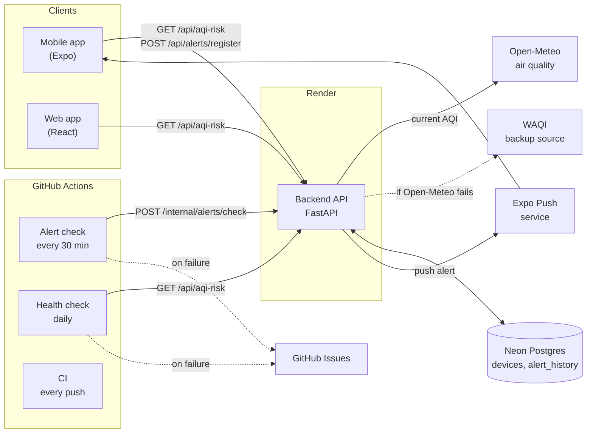

# AirIntel

AirIntel tells people with asthma whether the air where they are right now is a risk. It reads the current Air Quality Index (AQI) for your location, finds the worst pollutant, and turns it into a plain asthma-risk level with advice. The mobile app can also send a push alert when the air near you turns unhealthy.

| Part | Folder | Tech | Where it runs |
|---|---|---|---|
| Backend API | `backend/` | Python, FastAPI, SQLAlchemy, Alembic | Render (free web service): `https://airintel-backend-c61b.onrender.com` |
| Mobile app | `mobile/` | Expo / React Native | Expo Go on your phone |
| Web app | `frontend/` | React, Vite | Locally |
| Alerts database | — | Postgres | Neon (free plan) |

## Architecture



## How it works

1. The app gets your location and calls `GET /api/aqi-risk?lat=…&lon=…`.
2. The backend fetches the current US AQI for each pollutant (PM2.5, PM10, ozone, NO2, SO2, CO) from [Open-Meteo](https://open-meteo.com/en/docs/air-quality-api). No API key needed.
3. The worst pollutant sets the EPA category (Good → Hazardous), which maps to an asthma risk level: `low`, `moderate`, `high`, `very_high` or `severe`, plus advice.
4. For alerts, the mobile app registers its push token and location. A scheduled GitHub Actions job asks the backend every 30 minutes to check each registered device and send an Expo push notification when risk becomes `high` or worse. Every reading is saved to `alert_history` for 90 days, and devices Expo reports as uninstalled are removed.

**Staying up:** Open-Meteo is retried once. If it still fails and `WAQI_TOKEN` is set, the backend falls back to [WAQI](https://aqicn.org/api/). If every source fails, the API returns `502` rather than crashing. A failed push is retried on the next run.

## API

| Method | Path | Purpose |
|---|---|---|
| `GET` | `/api/aqi-risk?lat=&lon=` | Current AQI and asthma risk for a location |
| `GET` | `/healthz` | Liveness check (used by Render and Docker) |
| `POST` | `/api/alerts/register` | Save a device's push token and location |
| `POST` | `/api/alerts/unregister` | Remove a device |
| `POST` | `/internal/alerts/check` | Run the alert check and return a summary; needs the `X-Alert-Secret` header |
| `GET` | `/internal/stats?days=7` | Alert statistics (totals, by risk level, by pollutant, per device); needs the `X-Alert-Secret` header |

Interactive API docs are served at `/docs`. The alert and stats endpoints return `503` if no database is configured.

Every response has an `X-Request-ID` header matching the `request_id` in the server logs. Public endpoints are rate limited per IP: 30 risk lookups and 10 alert registrations per minute, after which the API returns `429`. See [SECURITY.md](SECURITY.md) for the full list of protections.

## Database

Postgres in production, managed with [Alembic](https://alembic.sqlalchemy.org/) migrations in `backend/migrations/`. Pending migrations run automatically when the app starts, so a deploy never needs a manual step.

| Table | Contents |
|---|---|
| `devices` | Registered push tokens, their location, and the last risk level they were alerted about |
| `alert_history` | One row per device per alert check: AQI, category, risk level, main pollutant, and whether a push was sent. Linked to `devices` by a foreign key and kept for 90 days. |

The statistics behind `/internal/stats` are hand-written SQL (`backend/app/stats.py`) using joins, `GROUP BY` and conditional aggregation. They run unchanged on both Postgres and SQLite.

To change the schema, edit `backend/app/models.py`, then generate a migration:

```
cd backend
DATABASE_URL=postgresql://... alembic revision --autogenerate -m "describe the change"
```

## Run it locally

### Everything with Docker (backend + Postgres)

```
docker compose up --build
```

The API is on `http://localhost:8000` with a local Postgres, so alerts and stats work too. The alert secret is `local-dev-secret` unless you set `ALERT_CRON_SECRET`.

### Backend without Docker

```
cd backend
python3 -m venv .venv && source .venv/bin/activate
pip install -r requirements.txt
uvicorn app.main:app --reload
```

The AQI endpoint works with no configuration. For alerts, copy `.env.example` to `.env` at the repo root and fill in `DATABASE_URL` and `ALERT_CRON_SECRET`. A SQLite URL such as `sqlite:///./airintel.db` works for local testing.

### Web app

```
cd frontend
npm install
npm run dev
```

Opens on `http://localhost:5173` and calls a backend on `http://localhost:8000`. To use the live backend instead:

```
VITE_API_BASE_URL=https://airintel-backend-c61b.onrender.com npm run dev
```

Your browser will ask for location permission. Use `localhost`, not your Mac's network address: browsers block location on plain `http` pages.

### Mobile app

```
cd mobile
npm install
npx expo start --tunnel
```

Scan the QR code with Expo Go. The app reads the backend address from `EXPO_PUBLIC_API_BASE_URL`, so create `mobile/.env` containing:

```
EXPO_PUBLIC_API_BASE_URL=https://airintel-backend-c61b.onrender.com
```

This project uses Expo SDK 57. See `mobile/AGENTS.md` before changing mobile code.

## Admin tool

`backend/scripts/airintel_admin.py` checks on a running backend from the terminal:

```
cd backend
export BACKEND_URL=https://airintel-backend-c61b.onrender.com
export ALERT_CRON_SECRET=...

python scripts/airintel_admin.py health              # is it up, and how fast
python scripts/airintel_admin.py risk 38.9 -77.0     # risk for a location
python scripts/airintel_admin.py stats --days 30     # alert statistics as tables
python scripts/airintel_admin.py check-alerts        # run the alert check now
```

Failures print the HTTP status and request ID, so you can find the matching logs.

## Tests

Backend:

```
cd backend
pip install -r requirements-dev.txt
python -m pytest
```

The tests cover the AQI-to-risk mapping, the retry and fallback logic, the API responses, input validation, rate limiting, the alert secret, push notification handling, the stats SQL, and the migrations (including adopting the existing production table). They mock all network calls and use an in-memory database, so they run offline.

Web app:

```
cd frontend
npm test
```

## Deployment

The backend deploys to Render from `render.yaml` at the repo root. Pushing to `main` redeploys it. The same app also runs anywhere that runs containers, from `backend/Dockerfile`.

Environment variables:

| Variable | Required | Notes |
|---|---|---|
| `DATABASE_URL` | For alerts | Neon connection string. `postgres://` URLs are accepted too. |
| `ALERT_CRON_SECRET` | For alerts | Must exactly match the GitHub Actions secret of the same name. |
| `WAQI_TOKEN` | No | Turns on the backup AQI source. [Free token](https://aqicn.org/data-platform/token/). |
| `ALLOWED_ORIGINS` | No | Comma-separated origins allowed to call the API from a browser. Defaults to `http://localhost:5173`. |
| `LOG_LEVEL` | No | `DEBUG`, `INFO` (default), `WARNING` or `ERROR`. |
| `TRUST_PROXY` | No | Read the client IP from `X-Forwarded-For` for rate limiting. Turned on automatically on Render and Cloud Run. |
| `RATE_LIMIT_ENABLED` | No | Set to `false` to turn off rate limiting for local testing only. |

> **Don't use Render's free Postgres.** It expires 30 days after creation and is then deleted, which silently broke alerts once. Neon's free plan has no time limit. The backend reconnects automatically after Neon's idle sleep.

Python is pinned to 3.12.5 (`backend/.python-version`) and every backend dependency is pinned in `requirements.txt`, so a new package release can't break a deploy.

## Monitoring and operations

The backend writes one JSON log line per request (method, path, status, duration, request ID), plus a summary of every alert run. When something breaks, start with [docs/RUNBOOK.md](docs/RUNBOOK.md).

GitHub Actions workflows in `.github/workflows/`:

| Workflow | When | What it does |
|---|---|---|
| `tests.yml` | Every push and pull request | Backend tests, Bandit and pip-audit security scans; web app lint, tests, build and npm audit; builds the Docker image and smoke-tests it against a real Postgres |
| `health-check.yml` | Daily at 13:00 UTC | Checks the live backend returns a real risk assessment |
| `alert-check.yml` | Every 30 minutes | Runs the push alert check |

If the health check or alert check fails, the workflow opens a GitHub issue labelled `monitoring` with the error output and a link to the runbook. Repeated failures don't open duplicates, and the issue closes itself when the check passes again. Dependabot opens weekly pull requests for dependency updates.

These need the repository secrets `BACKEND_URL` and `ALERT_CRON_SECRET`.
